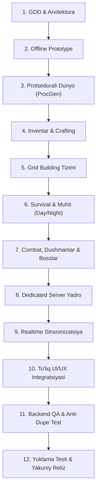

# 12-Loyiha: Mythic Realms (Capstone Project) — Texnik Topshiriq (TZ)

> **Loyiha turi:** Capstone / Yakuniy loyiha  
> **Murakkablik darajasi:** Ekspert  
> **Janr:** 2D Sandbox / Survival / Co-op Multiplayer  
> **Dvigatel:** Godot 4.x (Server-Authoritative Dedicated Server + Web/Desktop Client)  
> **Maqsadli platforma:** Windows Desktop & Web (HTML5)  

---

## 1. Umumiy konsept va Core Loop

O‘yinchilar yagona, protsedurali generatsiya qilingan 2D dunyoda resurslar yig‘adi, o‘z bazalarini quradi, buyumlar yasaydi (crafting) va PvE dushmanlardan himoyalanadi. Yakuniy maqsad — birgalikda bosslarni yengish va dunyo miqyosidagi global eventlarni bajarish.

```text
+-------------------------------------------------------------+
|                         CORE LOOP                           |
|                                                             |
|  [Tug'ilish/Spawn]                                          |
|         │                                                   |
|         ▼                                                   |
|  [Resurs qazish & Yig'ish] ──► [Crafting & Asboblar]        |
|         │                                │                  |
|         ▼                                ▼                  |
|  [Omon qolish (Ochlik/Jon)]    [Grid-based Baza qurish]     |
|         │                                │                  |
|         └───────────────┬────────────────┘                  |
|                         ▼                                   |
|             [Tungi reydlar & PvE Dushmanlar]                |
|                         │                                   |
|                         ▼                                   |
|             [Global Eventlar & Boss Janglari]               |
|                         │                                   |
|                         ▼                                   |
|          [Nodir Loot & Dunyo Progressiyasi]                 |
+-------------------------------------------------------------+
```

---

## 2. Boshqaruv sxemasi (Controls Spec)

| Tugma / Kirish | Harakat (Action) | Izoh / Kontekst |
|---|---|---|
| **W, A, S, D** | Harakatlanish | 8 yo'nalishli 2D harakat (Top-Down / Isometric) |
| **Mouse Aim** | Nishonga olish / Kursorni qaratish | Qurol, asbob va nishon yo'nalishi |
| **Mouse Left Click** | Asosiy harakat / Attack / Mine | Asbob bilan qazish yoki hujum qilish |
| **Mouse Right Click** | Ikkilamchi harakat / Place | Blok/qurilmani tarmoq (grid) bo'yicha joylashtirish |
| **E** | Interaksiya (Interact) | Sandiq, eshik, ish stoli va NPC bilan muloqot |
| **I** | Inventar (Inventory) | O'yinchi sumkasi va jihozlar panelini ochish/yopish |
| **C** | Crafting Menyusi | Retseptlar ro'yxati va yasash oynasini ochish |
| **1 – 8 (Raqamlar)** | Quick-slot (Hotbar) | Tezkor qo'lga olish paneli |
| **Esc** | Pause / Asosiy menyu | Tizim sozlamalari va o'yindan chiqish |

---

## 3. Asosiy mexanikalar va tizimlar arxitekturasi

### 3.1. Protsedurali Dunyo (ProcGen & Chunk Management)
* **Noise & Seed:** `FastNoiseLite` yordamida rel’ef, biomlar va namlik/harorat xaritalarini generatsiya qilish.
* **Biomlar (kamida 3 ta):** O‘rmon (Forest), Cho‘l (Desert), Muzlik/Botqoqlik (Tundra/Swamp).
* **G‘orlar va resurslar:** 2D Simplex/Perlin noise bo‘shliqlari orqali g‘orlar, ruda tomirlari (ore veins) va daraxt/tosh spawn qilish.
* **Chunk Tizimi:** Dunyo 16×16 (yoki 32×32) o‘lchamli bo‘laklarga (chunk) bo‘linadi; faqat o‘yinchilar atrofidagi faol chunklar xotirada ushlanadi.

### 3.2. Iqtisodiyot, Inventar va Crafting
* **Item Database:** Yagona `ItemData` (Custom Resource) asosida id, nom, ikonka, tur, max_stack, chidamlilik (durability) va parametrlar.
* **Stack & Durability:** Asboblar ishlatilganda sinadi; materiallar 64/99 tagacha bitta slotga yig‘iladi.
* **Crafting Tree:** Tier-based ierarxiya (Qo‘lda yasash → Yog‘och ish stoli → Temirchilik pechi → Sehrli laboratoriya).

### 3.3. Qurilish (Grid-based Building System)
* **TileMapLayer / Grid Align:** Obyektlar katakchalarga qat’iy joylashtiriladi (Snapping).
* **Qurilish turlari:** Devor (Wall), Pol (Floor), Eshik (Door - ochiq/yopiq holatlari), Ish stollari (Workbench), Saqlash qutilari (Chest), Himoya minoralari (Turrets/Traps).
* **Strukturaviy butunlik (Integrity):** Har bir inshoot HP ko‘rsatkichiga ega, dushmanlar tomonidan buzilishi mumkin.

### 3.4. Omon qolish va Muhit (Survival & Environment)
* **Kun/Tun Sikli:** 24 daqiqalik to‘liq sikl (masalan: 15 daqiqa kunduz, 9 daqiqa tun).
* **Light2D & Shadow:** Tunda yorug‘lik manbalari (mash’ala, o‘choq) talab etiladi.
* **Omon qolish parametrlari:** Health (HP), Hunger (Ochlik — vaqt o‘tishi bilan kamayadi, 0 ga tushsa HP pasayadi).

### 3.5. PvE va Eventlar
* **Dushman AI (State Machine):** Idle → Patrol → Detect Player/Base → Attack → Flee.
* **Tungi Reydlar (Raid Events):** Har $N$-kechada o‘yinchilar bazasiga dushman to‘lqinlari hujumi.
* **Boss Janglari:** Kamida 2 ta Boss (noyob harakat va fazalarga ega: Phase 1 & Phase 2).

### 3.6. Server-Authoritative Multiplayer & Tarmoq
* **Godot Multiplayer API:** `WebSocketMultiplayerPeer` (Web va Windows mijozlarining ikkalasini qo‘llab-quvvatlash uchun) yoki `ENetMultiplayerPeer`.
* **Server Avtoriteti:** 
  * Klient faqat input (harakat vektorlari, bosilgan tugmalar, nishon koordinatasi) yuboradi.
  * Server pozitsiyani hisoblaydi, to‘qnashuvlarni (collision) tekshiradi, qazish/joylashtirish huquqini tasdiqlaydi.
* **Anti-Dupe Tranzaksiyalari:** Sandiqdan buyum olish yoki o‘tkazish server tomonida atomik tranzaksiya sifatida bajariladi (ikkala o‘yinchi bir vaqtda bitta itemni ololmaydi).
* **RPC xavfsizligi:** Har bir `@rpc("any_peer")` funksiyasida `multiplayer.get_remote_sender_id()` orqali so‘rovchi klient huquqi qat’iy tekshiriladi.

### 3.7. Ma'lumotlar bazasi va Saqlash (Persistence)
* **World Save:** O‘zgargan tilelar, sandiqlar ichidagi buyumlar va dunyo vaqti muntazam diskka (SQLite yoki siqilgan binary/JSON) yoziladi.
* **Player Save:** O‘yinchi uzilib qayta kirganda (disconnect/reconnect) xuddi o‘sha koordinata, inventar va jon ko‘rsatkichi bilan tiklanadi.
* **Avtomatik Backup:** Har 15–30 daqiqada dunyo zaxira nusxasi olinadi.

---

## 4. Foydalanuvchi interfeysi (UI/UX Ekranlari)

1. **Kirish va Tayyorgarlik:**
   * Server Browser / Direct Connect (IP:Port kiritish oynasi).
   * Qahramon yaratish (Ism tanlash, rang/sprite sozlash).
2. **Gameplay HUD:**
   * Jon (HP bar) va Ochlik (Hunger bar).
   * 8 slotli Quick-Slot (Hotbar) va tanlangan asbob indikatori.
   * Day/Night soati va minimap.
3. **Inventar va Crafting:**
   * Ikki panelli oyna: Chapda o‘yinchi inventari (sumka + jihozlar), o‘ngda sandiq (agar ochilgan bo‘lsa) yoki crafting retseptlari.
4. **Qurilish rejimi (Build Mode):**
   * Quriladigan obyektlar preview-holatda (qizil = qurib bo‘lmaydi, yashil = ruxsat berilgan).
5. **Guruh va Boss paneli:**
   * Party a’zolari ro‘yxati (ularning HP lari bilan).
   * Global Boss HP bar ekranning yuqori markazida.
6. **Admin va Tizim menyusi:**
   * Chat / Buyruqlar konsoli (`/kick`, `/ban`, `/time set`, `/spawn`).
   * Sozlamalar (Ovoz, Grafika, Boshqaruv tugmalari).

---

## 5. Ishlab chiqish bosqichlari (12 bosqichli Pipeline)



1. **GDD va Arxitektura:** Resurslar balansi, crafting daraxti va tarmoq RPC arxitekturasini loyihalash.
2. **Offline Prototype:** Bir kishilik rejimda personaj harakati, kamera va oddiy to‘qnashuvlarni yaratish.
3. **World Generation:** Chunk generator, 3 ta biom, g‘orlar va resurs nodelarini yaratish.
4. **Inventory & Crafting:** Slot tizimi, drag-and-drop UI, stacking va item ma’lumotlar bazasi.
5. **Building System:** Grid asosida obyekt joylashtirish, devor, eshik va sandiqlar mantiqi.
6. **Survival & Environment:** Kun/tun yorug‘ligi, ochlik taymeri va vaqtga bog‘liq spawn.
7. **Combat & PvE:** Qurollar (qilich, kamon), dushman AI state machine va 2 ta boss mexanikasi.
8. **Server Backend:** Headless Godot server, dunyo holatini faylga/bazaga saqlash tizimi.
9. **Realtime Sync:** Harakat interpolyatsiyasi, tile o‘zgarishlarini barcha mijozlarga broadcast qilish.
10. **Frontend UI:** HUD, menyular, chat va server brauzerini to‘liq ulash.
11. **Backend QA & Edge Cases:** Paket yo‘qolishi (packet loss), parallel sandiq ochish va uzilishlarni testlash.
12. **Release:** Windows va Web buildlar, admin paneli va avtomatik zaxiralash tizimi.

---

## 6. MVP Qabul mezonlari (Definition of Done)

* [ ] **Biomlar:** Kamida 3 xil biom (O‘rmon, Cho‘l, Muzlik) seed asosida to‘g‘ri generatsiya bo‘lishi.
* [ ] **Iqtisodiyot:** Kamida 30 xil buyum/resurs va 25 ta ishlovchi crafting retsepti mavjudligi.
* [ ] **Qurilish:** O‘yinchi o‘z bazasini qura olishi (devorlar dushmanlarni to‘sishi, eshik ochilib-yopilishi, sandiq saqlashi).
* [ ] **PvE:** Kamida 4 turdagi oddiy dushman va 2 ta 2-fazali Boss jangi.
* [ ] **Multiplayer:** 2–8 nafar o‘yinchi bir vaqtda serverda birga o‘ynay olishi, harakat va qurilishlar to‘liq sinxron bo‘lishi.
* [ ] **Xavfsizlik:** O‘yinchi o‘zboshimchalik bilan inventariga item qo‘sha olmasligi (server-authoritative), buyum duplikatsiyasi (dupe) bloklangan bo‘lishi.
* [ ] **Persistence:** Server qayta yuklanganda (restart) dunyo xaritasi va o‘yinchilar progressi to‘liq tiklanishi.
